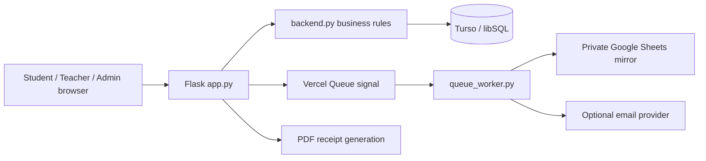

# Physics Plus

**A role-based tutoring center platform for students, teachers, and administrators.**

Physics Plus brings course enrollment, classroom scheduling, teaching records, billing, payment review, and staff operations into one web application. It is built with Flask and vanilla JavaScript, stores operational data in Turso, and runs on Vercel.

[Live website](https://physicsplus.vercel.app/) · [Portfolio case study](https://kitsanapuch.vercel.app/#physics-plus-project) · [Deployment guide](DEPLOY.md) · [Google Sheets guide](SHEET_GUIDE.md)


*The image above is a cropped public preview. It does not show private account or financial details.*

## What the platform does

| Workspace | Main capabilities |
| --- | --- |
| **Student** | Browse and enroll in courses, view classes and progress, receive account-specific notifications, review invoices, submit a payment slip, and download receipts for approved payments. |
| **Teacher** | View assigned classes, record actual teaching time, see payroll status, and request cancellation of an eligible future class with a reason. |
| **Administrator** | Manage courses, staff, rooms, schedules, enrollments, invoices, payment claims, teaching-hour approvals, payroll, assignments, reports, and Google Sheets sync status. |

The initial catalog covers **eight subjects**, each offered as a group course and a one-on-one course, for **16 course offerings**:

- Lower secondary: science, mathematics, and English.
- Upper secondary: physics, chemistry, biology, mathematics, and English.

Administrators control group-course prices, teachers, rooms, and schedules. The four classroom choices are a large room, a front small room, a back small room, and a small room behind the large room.

### Key workflows

1. **Enrollment and classes:** A student registers and requests a course. Administrators review enrollments, assign teachers, and schedule classes without automatically assigning a teacher or a room.
2. **Group-course billing:** Confirmed enrollment creates an invoice based on the administrator's configured course price. Students see the amount and payment instructions in their own account.
3. **One-on-one billing:** Teachers submit actual time, administrators verify attendance and approve that time, and monthly invoices are generated from approved minutes. The current rate is **THB 300 per teaching hour**.
4. **Payment review:** Students submit an image of a payment slip. The system screens image files and checks for duplicate submissions; QR information is supporting context only. An administrator must verify the bank receipt and approve or reject the claim. Approved payments produce an account-restricted PDF receipt.
5. **Class changes and communication:** A teacher may cancel only an eligible future class assigned to them, before attendance or teaching time has been recorded, and must provide a reason. Affected students and administrators see the update in their own workspace.
6. **Operations and reporting:** Account-specific notifications, assigned tasks, payroll review, CSV reports, and a private Google Sheets mirror help administrators follow work across the center.

## Architecture



The database is the source of truth. Business changes commit there before background delivery is requested. Queue messages wake a worker to sync Sheets and process email outside the original web request. If the queue is unavailable, the application attempts delivery in the request path; pending work remains in the database for retry. The in-app inbox is separate from outbound email. Outbound email can be paused with `PH_EMAIL_MODE=inbox_only` while account-specific notifications continue to work.

| Layer | Implementation |
| --- | --- |
| Frontend | HTML, CSS, vanilla JavaScript |
| Web/API | Python 3.12+, Flask |
| Data | Turso/libSQL |
| Background delivery | Vercel Queue, retry endpoints, Vercel Cron |
| Integrations | Private Google Sheets mirror; optional Gmail SMTP or Resend |
| Documents and uploads | ReportLab PDF receipts; Pillow and ZXing for payment-slip image/QR screening |
| Hosting | Vercel |

## Repository map

```text
app.py                Flask entry point, protected pages, API, and cron routes
backend.py            Business rules and role-based workflows
remote.py             Turso-backed application layer
public/               Public landing page and browser assets
private/              Session-protected dashboard shell
delivery_queue.py     Queue publisher
queue_worker.py       Background delivery worker
sheets_sync.py         Google Sheets mirror
mailer.py              Optional outbound email
receipt_pdf.py         PDF receipt rendering
manage.py              Database initialization and readiness commands
test_*.py              Automated tests
```

## Run locally

Use a **separate test database**. The application requires Turso credentials even for a local session; `.env.example` lists the supported configuration names but contains no real secrets.

```bash
git clone https://github.com/Kitsanapuch/Physics-Plus-Website.git
cd Physics-Plus-Website
python3 -m venv .venv
source .venv/bin/activate
python3 -m pip install -r requirements.txt
```

Set `TURSO_DATABASE_URL` and `TURSO_AUTH_TOKEN` in your local environment using a private, ignored secret manager or file. Set `PH_PUBLIC_ORIGIN=http://127.0.0.1:5000` for this local origin. Do not put real credentials in Git or in frontend files.

For a **new, empty test database only**, initialize the schema and create the first administrator through the interactive password prompt:

```bash
python3 manage.py init
python3 manage.py bootstrap-admin
python3 manage.py check
python3 -m flask --app app run --host 127.0.0.1 --port 5000
```

For an existing database, back it up and follow [DEPLOY.md](DEPLOY.md) before running migrations; do not repeat `bootstrap-admin` when an administrator already exists. Keep Preview and Production databases separate.

### Checks

```bash
python3 -m unittest discover -q
node --check public/live.js
```

The unit suite uses local test doubles and does not, by itself, prove that Turso, Vercel Queue, Google Sheets, or email delivery works in a deployed environment. Test those integrations with dedicated Preview data before releasing changes to Production.

## Deployment and configuration

`vercel.json` configures Flask deployment, daily retry cron jobs, and security headers. `pyproject.toml` declares the Vercel Queue subscriber. The detailed setup and release sequence live in [DEPLOY.md](DEPLOY.md); the Google Sheets mirror is described in [SHEET_GUIDE.md](SHEET_GUIDE.md).

Important environment variable names are documented in [.env.example](.env.example):

| Variable | Purpose |
| --- | --- |
| `TURSO_DATABASE_URL`, `TURSO_AUTH_TOKEN` | Server-side database connection |
| `PH_PUBLIC_ORIGIN` | Exact application origin when not supplied by Vercel |
| `PH_EMAIL_MODE` | `inbox_only` for in-app notifications without outbound email, or `email` after configuring a sender |
| `PH_GOOGLE_SHEET_ID`, `PH_GOOGLE_SERVICE_ACCOUNT_JSON` | Optional private Sheets mirror |
| `PH_GMAIL_USER`, `PH_GMAIL_APP_PASSWORD` or `RESEND_API_KEY`, `PH_EMAIL_FROM` | Optional outbound email |
| `CRON_SECRET` | Protects retry endpoints |
| `PH_DELIVERY_QUEUE_ENABLED` | Optional queue fallback control |

## Current limits

- Payment-slip image and QR checks are **preliminary screening**. They do not prove that money reached the bank account; an administrator must verify the transaction before approval.
- A successful local test suite does not establish end-to-end operation of external services. Real payment, Sheets, queue, and email flows should be checked on an isolated Preview environment with suitable test data.
- Outbound email may be intentionally paused while the in-app inbox remains available. It should be enabled only after sender configuration and delivery testing.
- Before live operational use, confirm that every teacher account is activated and test a real payment from invoice through independent bank verification, approval, and receipt generation. Those checks were still open in the last documented review.
- The administrator views for large histories and academic records may need additional pagination as data grows. See [QA_REPORT.md](QA_REPORT.md) for measured limitations and the original test context.

## สรุปภาษาไทย

Physics Plus เป็นเว็บจัดการร้านสอนพิเศษที่แยกพื้นที่ **นักเรียน ครู และผู้ดูแล** มีคอร์สกลุ่ม 8 วิชาและตัวต่อตัวอีก 8 วิชา รวม 16 คอร์ส ผู้ดูแลเป็นผู้กำหนดครู ห้องเรียน ตาราง และราคาคอร์สกลุ่ม ระบบไม่สุ่มมอบหมายครูหรือห้องเอง

- **นักเรียน:** สมัครคอร์ส ดูตารางและใบแจ้งยอด รับแจ้งเตือนในบัญชี แนบสลิป และดาวน์โหลดใบสำคัญรับเงินหลังผู้ดูแลอนุมัติ
- **ครู:** ดูคาบที่ได้รับมอบหมาย บันทึกเวลาสอนจริง และยกคาบในอนาคตที่ยังไม่มีการเช็กชื่อหรือบันทึกชั่วโมง โดยต้องระบุเหตุผล
- **ผู้ดูแล:** จัดการบัญชี คอร์ส ห้อง ตาราง ใบแจ้งยอด การตรวจชำระเงิน ชั่วโมงสอน ค่าจ้าง และสถานะซิงก์ Google Sheets
- **การชำระเงิน:** คอร์สตัวต่อตัวคิด 300 บาทต่อชั่วโมงที่สอนจริงและออกยอดรายเดือน การอ่านภาพหรือ QR จากสลิปเป็นเพียงตัวช่วยคัดกรอง ผู้ดูแลต้องตรวจเงินเข้าธนาคารจริงก่อนอนุมัติ

ข้อมูลหลักอยู่ใน Turso ส่วน Google Sheets เป็นสำเนาสำหรับติดตามงาน การแจ้งเตือนในเว็บทำงานแยกจากอีเมลที่สามารถพักส่งได้ด้วย `PH_EMAIL_MODE=inbox_only` ก่อนใช้งานจริงควรตั้งค่าบัญชีครูให้ครบและทดสอบกระบวนการชำระเงินจริงตั้งแต่ใบแจ้งยอดจนออกใบสำคัญรับเงิน

## Author

Built by [Kitsanapuch Chuaibamrung](https://github.com/Kitsanapuch). See the [portfolio case study](https://kitsanapuch.vercel.app/#physics-plus-project) for the product story and a gallery of approved preview images.
